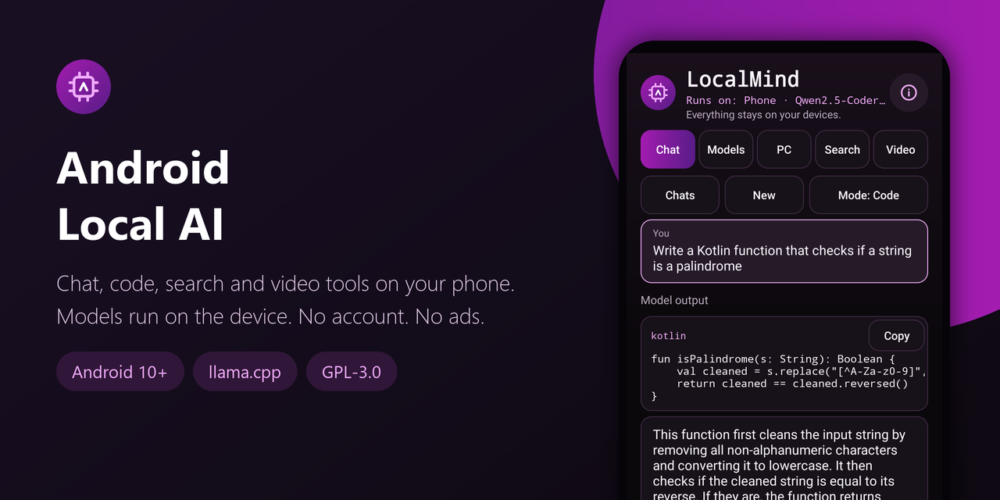
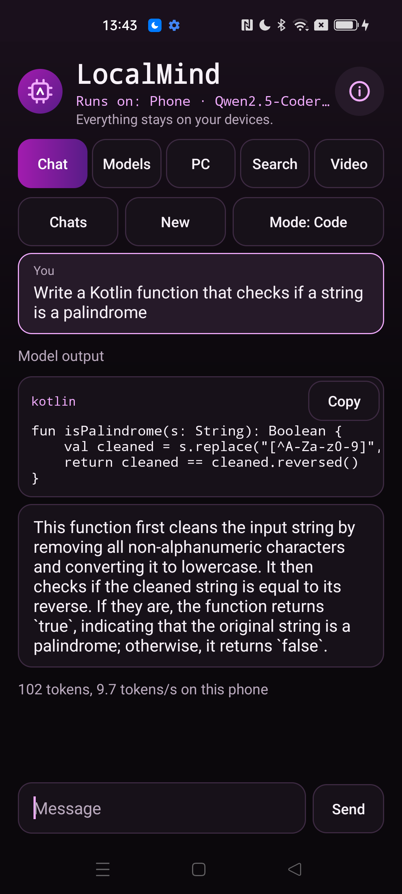
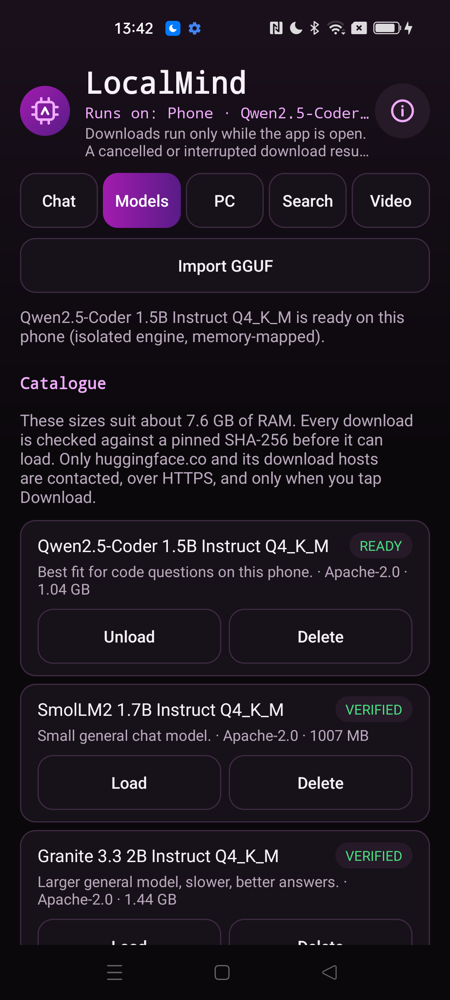
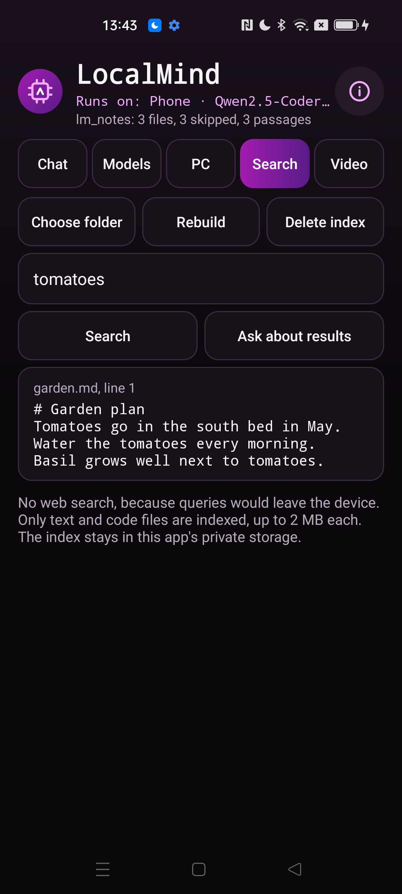
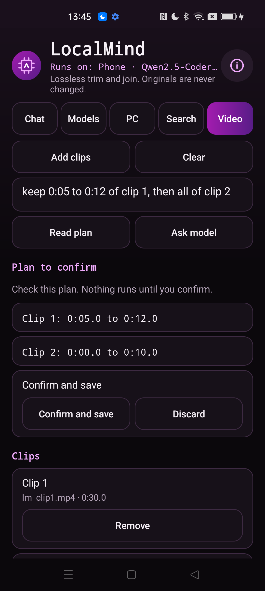
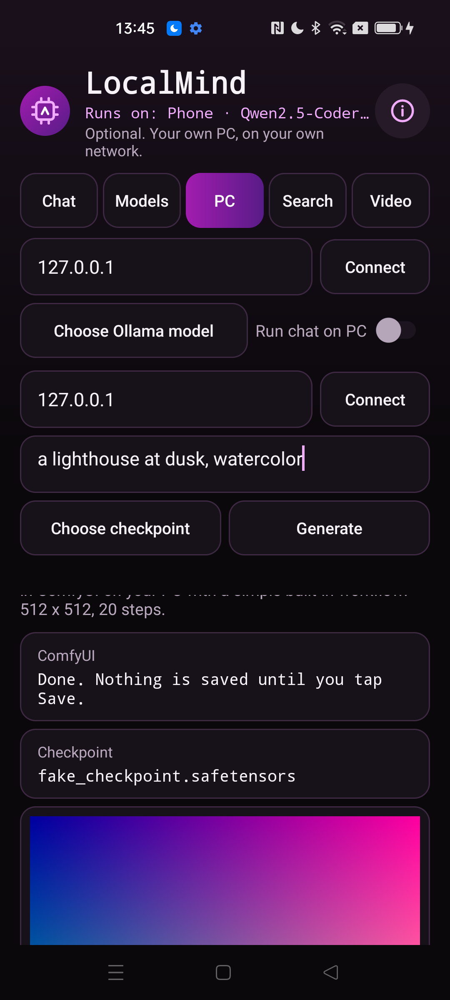

<div align="center">



# Android Local AI

**Chat and code with a small language model that runs on your phone, search your own files offline, and trim or join videos without re-encoding. Optional use of your own PC for bigger models and images. Open source, no ads, no analytics, no account.**

[](LICENSE)
[](#requirements)
[](https://kotlinlang.org)
[](THIRD_PARTY.md)
[](app/build.gradle.kts)
[](https://github.com/Nekuzaky/android-local-ai/stargazers)

</div>

Android Local AI ships an app called **LocalMind**. What you type stays on your own devices: a model on the phone, or your own PC on your own network if you choose to connect one.

It does what a phone can do in a useful way and says plainly what it cannot. See [Limitations](#limitations).

## Screenshots

<p align="center">
  
  
  
  
  
</p>

## Features

- **Chat on the phone:** streaming answers from a small model through [llama.cpp](THIRD_PARTY.md), with a Stop button and a tokens-per-second note under each answer
- **Code mode:** a code-focused system prompt, code blocks shown in a monospaced font with a Copy button
- **Conversations:** kept per conversation in the app's private storage, with a list to reopen or delete them
- **Model catalogue:** three permissively licensed models, downloaded only when you tap Download, with progress, cancel and resume
  - Qwen2.5-Coder 1.5B Instruct Q4_K_M, Apache-2.0, 1.04 GB
  - SmolLM2 1.7B Instruct Q4_K_M, Apache-2.0, 1007 MB
  - Granite 3.3 2B Instruct Q4_K_M, Apache-2.0, 1.44 GB
- **Hash checks:** every catalogue file is pinned to a commit and a SHA-256 from Hugging Face, and it is hashed again before every load
- **Import a GGUF** of your own through the file picker, marked unverified, with a warning
- **Offline search:** pick a folder, LocalMind indexes its text and code files privately and ranks results with BM25. **Ask about results** passes the top passages to the current model
- **Video:** pick clips, then trim and join them without re-encoding, saved as a new file in Movies/LocalMind. Type a plan such as `keep 0:10 to 0:40 of clip 1, then all of clip 2`, or ask the model to write one. Every plan is checked against the clips and shown to you, and nothing runs until you confirm
- **Your PC, optional:** an Ollama server for chat, code and vision on a picked image, and a ComfyUI server for text to image with a simple built-in workflow. An image is saved only when you tap Save
- **Status line:** always shows where the current model runs, the phone or a PC address
- No ads, no analytics, no account, no logging, and no third-party library besides llama.cpp

## How it works

- **Engine:** llama.cpp is built from source for arm64-v8a CPUs and called through a thin JNI layer. It runs in a separate, isolated Android process, so a crash or an out-of-memory in the engine does not close the app. The app shows a message and a **Restart engine** button.
- **Isolation:** the engine runs as an Android isolated process. Android gives such a process its own user ID and no permissions, so it cannot use the network or open the app's files. It only receives a read-only handle to the one model file it should load, after the app has checked its hash.
- **Memory:** model weights are memory-mapped from the file, and the app checks free memory before loading and refuses a model that will not fit.
- **Prompts:** the chat template stored in the model is used through llama.cpp's built-in template list. No Jinja engine runs. Special tokens such as `<|im_start|>` are neutralised in everything you type and in every document passage.
- **Search:** files are read through the storage access framework with size caps. Binaries, hidden files and files over 2 MB are skipped. The index is a JSON lines file in private storage.
- **Video:** `MediaExtractor` and `MediaMuxer` copy compressed samples as they are. Clips are joined only when their codec, size, rotation and codec configuration match.

## Privacy and security

- The Internet permission is used for two things only: downloading a model from Hugging Face when you tap Download, and talking to your own PC if you set one up.
- Downloads use HTTPS only, follow redirects only to `huggingface.co`, `hf.co` and their subdomains, and are rejected unless the SHA-256 matches.
- PC addresses must resolve to private, loopback or link-local addresses. LocalMind checks every resolved address, connects to the checked address, and follows no redirects. This traffic is not encrypted, so use it only on a network you trust.
- Every network response has a size cap, a read timeout and a total deadline.
- **Model output is only displayed.** It never opens links, runs code, reads files or calls anything. A video plan from a model is validated against a strict schema and the clip lengths, shown to you, and runs only after you confirm it.
- **No phone control.** LocalMind has no accessibility service, so it cannot operate your phone, and that is on purpose.
- Text from documents, images, model output and PC servers is treated as hostile: control, bidi and invisible characters are removed and lengths are capped before display.
- Backups are off, and `dataExtractionRules` excludes everything from cloud backup and device transfer.
- Only the launcher activity is exported, and it reads nothing from its intent. The engine service is not exported.
- Buttons that send or change things ignore touches when another window covers them.

### Permissions

| Permission | Why it is needed |
| --- | --- |
| `INTERNET` | Downloading a model from Hugging Face when you tap Download, and reaching your own Ollama or ComfyUI server on your network. Nothing else is sent anywhere |

## Requirements

- Android 10 (API 29) or later, on a 64-bit ARM phone whose CPU supports the `asimddp` and `asimdhp` features. LocalMind checks this before loading a model
- About 2 to 3 GB of free memory for the models in the catalogue
- JDK 21, Android SDK 35, NDK 27.3.13750724 and CMake 3.22.1 to build from source

Gradle 8.11 does not support the Java 25 runtime bundled with recent Android Studio versions, so use a separate JDK 21.

## Download

Download the signed APK from the [latest release](https://github.com/Nekuzaky/android-local-ai/releases/latest) and open it on your phone. Android may ask you to allow installs from the app you opened it with.

The release notes list the SHA-256 checksum of the APK and of its signing certificate.

## Build from source

A build signed with your own key cannot install over the release APK, so uninstall the app first.

```bash
git clone https://github.com/Nekuzaky/android-local-ai.git
```

```bash
cd android-local-ai
```

Create a `local.properties` file that points to your Android SDK:

```properties
sdk.dir=/path/to/Android/Sdk
```

Install the NDK and CMake with the SDK manager:

```bash
sdkmanager "ndk;27.3.13750724" "cmake;3.22.1"
```

Build a debug APK with JDK 21. No signing setup is needed:

```bash
JAVA_HOME=/path/to/jdk-21 ./gradlew assembleDebug
```

Run the unit tests:

```bash
JAVA_HOME=/path/to/jdk-21 ./gradlew testDebugUnitTest
```

Install it on a phone with USB debugging enabled:

```bash
adb install -r --user 0 app/build/outputs/apk/debug/app-debug.apk
```

### Fake PC backends for testing

`scripts/fake_backends.py` uses only the Python standard library to fake Ollama and ComfyUI on `127.0.0.1`. Use `adb reverse` so the phone can reach it:

```bash
python scripts/fake_backends.py
```

```bash
adb reverse tcp:11434 tcp:11434
```

```bash
adb reverse tcp:8188 tcp:8188
```

Then enter `127.0.0.1` on the PC tab. Add `--hostile` for bad names, redirects and path traversal, or `--mode huge` or `--mode stall` for oversized and stalling answers.

### Signed release build

Create a signing key, then add a `keystore.properties` file at the project root. It is ignored by Git, so never commit it or your key:

```properties
storeFile=/path/to/your-key.jks
storePassword=your-password
keyAlias=release
keyPassword=your-password
```

```bash
JAVA_HOME=/path/to/jdk-21 ./gradlew assembleRelease
```

Without `keystore.properties` the build still works, and `assembleRelease` produces an unsigned APK.

## Limitations

What LocalMind does **not** do:

- **It does not generate images on the phone itself.** A phone cannot do it in a usable way. Text to image works only through ComfyUI on your own PC.
- **It does not search the web.** Search queries would leave your device, so search covers only a folder you pick on the phone.
- **It does not apply video effects.** No filters, transitions, titles or re-encoding. Clips that differ in codec, size or settings are refused, not converted.
- **It does not operate the phone.** There is no accessibility service and no tool use. Model output is only shown.

Other limits:

- **Small models.** The models that fit a phone are far weaker than large online assistants. Answers can be wrong, and the model may write a video plan that fails the checks.
- **Speed.** On the test phone, answers came at about 6 to 10 tokens per second, and a long conversation slows the start of each answer because the whole prompt is processed again.
- **Video cuts.** A trim can only start on a keyframe, so it may begin slightly before the time you asked for. It stops at the first frame that reaches your end time, so **trims on clips with B-frames may end a few frames early**.
- **Background work.** Downloads, generation and video saving run only while the app process is alive. There is no foreground service. An interrupted download resumes when you tap Resume.
- **Imported models.** A damaged or malicious GGUF could still crash or attack the engine process. That process is isolated from your files and the network, but import only files you trust.
- **One ABI.** Only arm64-v8a is built.
- **Documents provider.** Search sees files the system documents provider lists. Files copied in by some tools may only appear after the media scanner has seen them.
- **Real Ollama and ComfyUI are untested.** The PC features were tested only against the fake servers in `scripts/fake_backends.py`.

## Test status

Unit tests for the current source: 222 pass under `testDebugUnitTest`, on the JVM. They cover the address guard, the download URL allow-list, hash checks, resumable downloads against a local server, the JSON parser with hostile input, the video plan parser and validator, BM25, the chat history codec with corruption, the ComfyUI workflow builder and the network size and time limits.

Tested with a debug build on one phone: Oppo Reno4 Z 5G, Android 12, ColorOS, 7.6 GB RAM.

| Check | Result |
| --- | --- |
| Engine process | Runs as an isolated user ID (`u0_i…`), separate from the app |
| Load SmolLM2, Qwen2.5-Coder and Granite in the isolated engine | Works, memory-mapped |
| Speed and engine memory | SmolLM2 8.6 tokens/s, about 1.9 GB. Qwen2.5-Coder 9.7 tokens/s, about 1.4 GB. Granite 6.4 tokens/s, about 2.0 GB |
| Download, cancel at about 100 MB, resume, SHA-256 check | Resumed from the partial file and passed |
| Model file changed by 4 bytes after download | Refused before loading |
| Imported files: not GGUF, absurd header, lying header, random body, truncated real model | Refused at import or failed to load with a message, no crash |
| Engine killed during an answer | App stayed open, partial answer kept, Restart engine worked |
| Stop during an answer | Stopped |
| Code mode answer with code block and Copy | Works |
| Ask about results with a file containing a prompt injection | Answered from the file, did not follow the injected text |
| Fake Ollama chat and image attached for vision | Works |
| Fake ComfyUI text to image and Save | Works, saved to Pictures/LocalMind |
| Hostile fake servers: bad model names, redirect, path traversal in an image name | Names filtered, redirect refused, image not requested |
| Oversized answers from both fake servers | Stopped with a message |
| A server that sends one byte every 5 seconds | Stopped at the 120 second deadline |
| Trim with a cut inside a group of pictures, on a clip with B-frames | Exact frame count, no decode errors, originals unchanged |
| A trim of one clip joined with a whole second matching clip | 540 frames as expected, no decode errors |
| Join of clips with different sizes | Refused with the clip number |
| Plans that are impossible or ask for effects | Refused with reasons |
| Rotation during an answer, leaving and returning, process death | No crash, the answer continued, the tab, text and clip list came back |
| 2000 random taps with `monkey` | No crash |

Not tested: real Ollama and ComfyUI servers, a probe of network or file access from inside the engine process, a trim where frames were actually dropped at the end of a B-frame clip, a phone without the required CPU features, a refusal for lack of memory on a real phone, a full disk during a download, Android 10, 11, 13 and later, other brands, tablets, and work profiles. If something breaks on your phone, please open an issue.

## Related

- [Android Dev Toolbox](https://github.com/Nekuzaky/android-dev-toolbox): JSON, JWT, regex, hashes and more, offline.
- [Android APK Inspector](https://github.com/Nekuzaky/android-apk-inspector): see how any installed app is built.
- [Android App Firewall](https://github.com/Nekuzaky/android-app-firewall): cut Internet access per app.
- [Android Permission Manager](https://github.com/Nekuzaky/android-permission-manager): see what every app can access.
- [Android Tracker Detector](https://github.com/Nekuzaky/android-tracker-detector): find tracking code inside your apps.

## License

Distributed under the [GNU General Public License v3.0](LICENSE). llama.cpp is under the MIT License, see [THIRD_PARTY.md](THIRD_PARTY.md).
